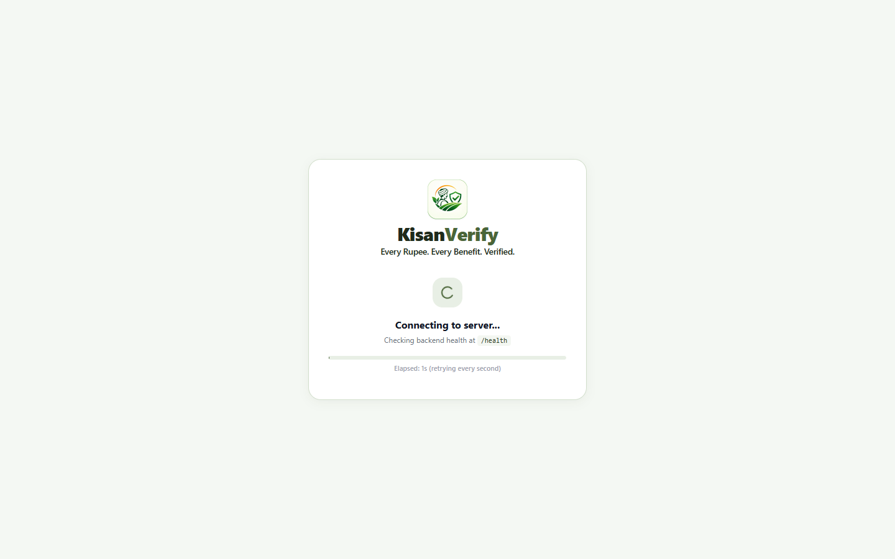
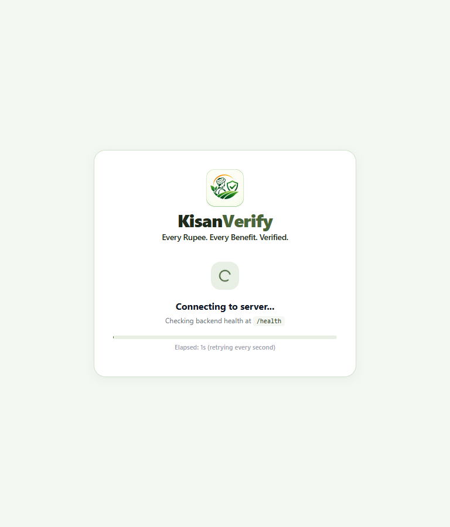
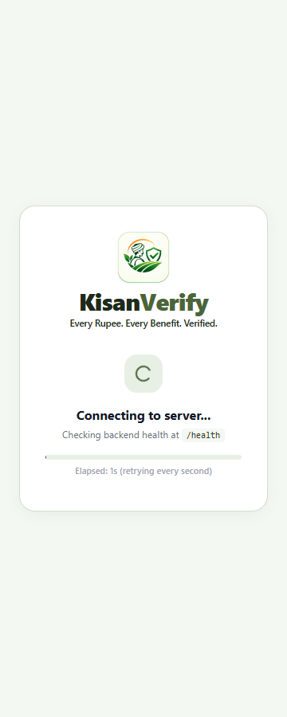

<p align="center">
  
</p>

# KisanVerify (किसानवेरीफाई)

> **"Every rupee. Every benefit. Verified."**  
> *Agricultural Financial Transparency & Policy Simplification Platform*

KisanVerify is a farmer-first agricultural financial transparency platform that makes financial records, government subsidies, and bank reconciliations clear, verifiable, and actionable. It empowers Indian farmers to audit their Kisan Credit Card (KCC) loans, Minimum Support Price (MSP) grain sales, crop insurance payouts (PMFBY), and direct benefit transfers (PM-KISAN).

By comparing sanctioned vs. disbursed funds and expected vs. actual market payouts, KisanVerify deterministically flags records that may need institutional review, explains discrepancies in plain conversational Hindi and English without accusatory rhetoric, enables voice interactions for low-literacy users, and provides administrative oversight tools for banks and agricultural officials.

---

## 📱 Responsive Multi-Device Architecture (Mobile, Tablet & Desktop)

KisanVerify is engineered with a **single unified codebase** that adapts dynamically across phones, tablets, laptops, and desktops, implementing two precise visual designs:

- **Desktop & Tablet Reference (Image A)**: Comprehensive web dashboard with a 240px fixed forest-green navigation sidebar, top greeting header, 4-column executive metric cards, side-by-side verification forms, and interactive reconciliation tables.
- **Mobile Phone Reference (Image B)**: 10 dedicated mobile screens featuring a dark forest header band, 5-tab fixed bottom navigation bar, 2×2 touch action tiles, stacked discrepancy audit cards, and bottom-sheet review dialogs.

```
+----------------------------------------------------------------------------------------------------+
|                                    BREAKPOINT ARCHITECTURE                                         |
+------------------------------+-------------------------------------+-------------------------------+
|  Phones (< 768px)            |  Tablets (768px - 1023px)           |  Desktops (>= 1024px)         |
|  Image B Reference           |  Adaptive Bridge                    |  Image A Reference            |
+------------------------------+-------------------------------------+-------------------------------+
| - Dark forest top band       | - Collapsible sidebar / top bar     | - Fixed 240px forest sidebar  |
| - Fixed 5-tab bottom bar     | - 2-column grid forms               | - Top bar with farmer profile |
| - 2x2 grid action tiles      | - 2x2 stat cards                    | - 4-column metric cards       |
| - Stacked review cards       | - Responsive data tables            | - 2-column verify (7/5 split) |
| - Bottom-sheet modals        | - Centered modal dialogs            | - Full reconciliation tables  |
| - 44px+ touch targets        | - Dual-column layout                | - Comprehensive analytics     |
| - Zero horizontal scroll     | - Zero horizontal scroll            | - Zero horizontal scroll      |
+------------------------------+-------------------------------------+-------------------------------+
```

### Shared Design Tokens

All screens share an exact tokenized palette sampled directly from the design mockups:

| Token | Hex Value | Purpose |
| :--- | :--- | :--- |
| **Forest** | `#4A6538` | Headers, desktop sidebar, splash screens, leading accents |
| **Olive** | `#5B7A47` | Primary buttons, active tabs, interactive links |
| **Tint** | `#E4EBD6` | Icon boxes, pill backgrounds, illustration accents |
| **Cream** | `#F7F5EC` | Application background |
| **Card Surface** | `#FDFCF8` | Cards and panels with 1px `#E8E5DA` border & soft shadow |
| **Charcoal** | `#1F2A1B` | Headings, primary text |
| **Muted** | `#6B7565` | Subtitles, labels, secondary text |
| **Status: Eligible** | `#EBF2DE` / `#335C24` | Approved, verified, eligible records |
| **Status: Review** | `#FDF0E2` / `#8C531E` | Under review, possibly eligible, pending |
| **Status: Discrepancy** | `#FCEAE4` / `#B83227` | Needs review, discrepancy detected |
| **Saffron Accent** | `#FE900A` (`#F7941D`) | Sampled from logo arc for micro-accents and active highlights |

### PWA & Native-Like Experience
- **Web App Manifest**: Full `manifest.webmanifest` with standalone display mode.
- **Custom SVG App Icon**: High-contrast seedling leaf logo.
- **Safe Area Insets**: `env(safe-area-inset-bottom)` support on mobile bottom navigation.
- **Typography**: Inter / Plus Jakarta Sans combined with Noto Sans Devanagari for clean bilingual Hindi rendering.

---

## 🏛️ Government-Portal-Style Responsive Footer & Transparency Framework

KisanVerify features an accessible, government-portal-style footer adhering to rural design tokens (`#4A6538` dark olive background, `#FF9933` saffron accent line, `#F7F5EC` cream typography):

<p align="center">
  
</p>

### Responsive Multi-Viewport Adaptations
- **Desktop (1440px & 1024px)**: 4-column structured grid (Brand, Quick Links, Information & Support, Verified Official Government Links) with inline help strip, prototype legal disclaimer, and bottom bar.
- **Tablet (768px)**: 2×2 grid layout with accessible touch-friendly spacing and clear navigation grouping.
- **Mobile Phones (360px)**: Collapsible accordion sections for links with dedicated `pb-24` padding ensuring zero overlap with the fixed 5-tab mobile bottom bar.

<p align="center">
  
  
</p>

### Key Footer & Policy Elements
1. **Verified Government Links**: Direct `target="_blank" rel="noopener noreferrer"` links to official portals:
   - National Portal of India: [india.gov.in](https://www.india.gov.in)
   - Ministry of Agriculture & Farmers Welfare: [agriwelfare.gov.in](https://agriwelfare.gov.in)
   - PM-KISAN Portal: [pmkisan.gov.in](https://pmkisan.gov.in)
   - PMFBY Crop Insurance: [pmfby.gov.in](https://pmfby.gov.in)
   - e-NAM (National Agriculture Market): [enam.gov.in](https://enam.gov.in)
   - Soil Health Card Portal: [soilhealth.dac.gov.in](https://soilhealth.dac.gov.in)
   - India Meteorological Department: [mausam.imd.gov.in](https://mausam.imd.gov.in)
   - Kisan Call Centre / mKisan Portal: [mkisan.gov.in](https://mkisan.gov.in)
2. **Help Strip**: Toll-free Kisan Call Centre (`1800-180-1551`) with one-tap dialing and support email.
3. **Legal Prototype Disclaimer**: Clear notice that KisanVerify is an independent civic hackathon prototype not affiliated with GoI, containing synthetic demo records (no misuse of State Emblems).
4. **Policy Pages Suite**: Complete bilingual (EN/HI) pages for:
   - [About KisanVerify](file:///c:/hackathon/KishanVerify/frontend/src/pages/policies/AboutPage.tsx) (`/about`)
   - [Terms & Conditions](file:///c:/hackathon/KishanVerify/frontend/src/pages/policies/TermsPage.tsx) (`/terms`)
   - [Privacy Policy](file:///c:/hackathon/KishanVerify/frontend/src/pages/policies/PrivacyPage.tsx) (`/privacy`)
   - [Disclaimer](file:///c:/hackathon/KishanVerify/frontend/src/pages/policies/DisclaimerPage.tsx) (`/disclaimer`)
   - [Hyperlinking Policy](file:///c:/hackathon/KishanVerify/frontend/src/pages/policies/HyperlinkPolicyPage.tsx) (`/hyperlinking-policy`)
   - [Copyright Policy](file:///c:/hackathon/KishanVerify/frontend/src/pages/policies/CopyrightPage.tsx) (`/copyright-policy`)
   - [Accessibility Statement](file:///c:/hackathon/KishanVerify/frontend/src/pages/policies/AccessibilityPage.tsx) (`/accessibility`)
   - [Help & FAQ](file:///c:/hackathon/KishanVerify/frontend/src/pages/policies/FaqPage.tsx) (`/faq`)
   - [HTML Sitemap](file:///c:/hackathon/KishanVerify/frontend/src/pages/policies/SitemapPage.tsx) (`/sitemap`)
5. **Accessibility**: `footer[role="contentinfo"]`, `<nav aria-label>`, keyboard focus rings, "Skip to main content", "Back to top", and >5.4:1 WCAG AA contrast ratio.


---

## 🏛️ System Architecture

```
                                      +--------------------------+
                                      |   Farmer Mobile & Web    |
                                      |   Admin Web Dashboard    |
                                      +-------------+------------+
                                                    | (REST / JSON)
                                                    v
+---------------------------------------------------+---------------------------------------------------+
|                                            FastAPI Backend                                            |
|                                                                                                       |
|  +--------------------+   +-----------------------+   +-----------------------+   +----------------+  |
|  | Verification Engine|   | Scheme Recommendation |   |  AI Policy Simplifier |   | PDF Generation |  |
|  | (Deterministic)   |   | (Rule-Based Engine)   |   |  (Gemini + Fallback)  |   | & OCR Intake   |  |
|  +--------------------+   +-----------------------+   +-----------------------+   +----------------+  |
|                                                    |                                                  |
|                                                    v                                                  |
|                               +--------------------+---------------------+                            |
|                               |     SQLAlchemy ORM + SQLite / PG         |                            |
|                               +------------------------------------------+                            |
+-------------------------------------------------------------------------------------------------------+
```

---

## 🎯 Core Engineering Principles

1. **Deterministic Calculations First**: All mathematical reconciliations (differences, deductions, interest rates, eligibility criteria) are calculated strictly in verified, unit-tested Python functions. **The AI never computes or hallucinates financial balances.**
2. **Neutral & Non-Accusatory Tone**: All discrepancy notices explicitly state *"Needs Review"* or *"Possible Discrepancy"*. Explanations guide farmers towards transparent bank verification rather than alleging misconduct or fraud.
3. **Inclusive & Accessible**:
   - Palette: Earthy sage/olive green (`#4A6538`, `#5B7A47`, `#F7F5EC`, `#E4EBD6`) matching rural design standards.
   - Large touch-friendly controls (minimum 48px height) for mobile field use.
   - Native Hindi (`hi-IN`) and English voice input (STT) and voice speech-out (TTS) via Web Speech API.
   - Official downloadable PDF reports with QR verification stamps and audit trails.

---

## 📱 Feature Highlights

### Farmer Portal (Mobile-First & Desktop Adaptive)
- **Home Hub**: Farmer greeting (`Namaste, Ramesh Kumar`), quick speech inquiry mic, 4 core action tiles (My Schemes, My Loan, MSP Payments, Crop Insurance), and attention alerts.
- **Deterministic Verification Engines**:
  - **KCC Loan Verification**: Sanctioned vs. disbursed audit, processing/insurance deductions table, interest subvention audit.
  - **MSP Mandi Verification**: Weight $\times$ MSP benchmark formula vs. bank account credit difference breakdown.
  - **Crop Insurance (PMFBY)**: Assessed loss claim vs. credited compensation tracker.
- **Multilingual AI Assistant**: Conversational explanations powered by Gemini with offline deterministic fallback. Quick question chips, full text-to-speech, and microphone input.
- **Scheme Eligibility Checker**: Dynamic eligibility rule engine covering PM-KISAN, PMFBY, KCC, and State Input Subsidies with document checklists and deadlines.
- **Official Grievance Flow**: Form with 300-character description limit, optional document upload, and automated tracking ticket generation (e.g. `GRV-2025-0891`).
- **Reports & PDF Export**: Instant download of official, tamper-evident discrepancy audit reports generated via ReportLab.

### Bank & Administrative Console
- **Executive Stat Cards**: Real-time counts of Total Processed Records, 100% Verified Accounts, Flagged Discrepancies, and Pending Grievances.
- **Interactive Discrepancy Case Management**: Search and filter by district, branch, or status with one-click case resolution and escalation modal.
- **Data Analytics (Recharts)**: Bar charts for discrepancies by district, status breakdown donuts, and weekly trend analysis.
- **Audit Export**: Single-click CSV export of all audit logs for district lead bank meetings and vigilance reviews.

---

## 🛠️ Tech Stack

- **Frontend**: React 18, TypeScript, Vite, Tailwind CSS, Lucide Icons, Recharts, canvas-confetti, react-router-dom.
- **Backend**: Python 3.11+, FastAPI, Pydantic v2, SQLAlchemy ORM, SQLite (`kisanverify.db`), ReportLab, PyMuPDF.
- **AI Intelligence**: Google Gemini API via `google-genai` SDK with deterministic rule-based template fallback.
- **Voice Interactivity**: Browser Web Speech API (`SpeechRecognition` & `speechSynthesis`) in Hindi and English.
- **Testing**: Pytest with automated coverage for zero-difference, negative difference, deduction breakdowns, and non-accusatory language rules.

---

## 🚀 Quickstart & One-Command Startup

### Prerequisites
- **Node.js**: v18+ (v20+ recommended)
- **Python**: v3.11+
- **Git**

---

### Option A: One-Command Start (Recommended for Development)

Clone the repository and run setup once:
```bash
git clone https://github.com/yaminii-sahu/KishanVerify.git
cd KishanVerify

# 1. Automated cross-platform setup (virtualenv, python deps, node deps)
npm run setup

# 2. Launch backend, frontend with proxy, and open browser automatically
npm start
```

> **Windows One-Click**: You can also simply double-click `start.bat` in the root folder.  
> **macOS / Linux**: Run `./start.sh`.  
> **VS Code**: Simply open this folder in VS Code — `.vscode/tasks.json` starts servers automatically.

The browser will open at [http://localhost:5173](http://localhost:5173) with automatic proxying to the FastAPI backend at [http://localhost:8000](http://localhost:8000). A connection gate smoothly transitions into the app as soon as the backend `/health` endpoint responds.

---

### Option B: Single-Port Production Mode (No Vite, Single Port 8000)

If you want to run the entire application (React SPA + FastAPI backend + PDF generator) from a single port:

```bash
npm run build:serve
```
This builds the frontend production bundle and mounts it directly inside FastAPI with SPA deep-link fallback. Open [http://localhost:8000](http://localhost:8000).

---

### Option C: Docker Containerization

To run KisanVerify inside an isolated container with Tesseract OCR pre-installed:

```bash
docker compose up --build
```
Access the application at [http://localhost:8000](http://localhost:8000).

---

### Option D: Manual Component Startup

<details>
<summary>Click to view manual backend and frontend steps</summary>

#### Backend
```bash
cd backend
python -m venv .venv
# Windows:
.venv\Scripts\activate
# macOS/Linux:
source .venv/bin/activate

pip install -r requirements.txt
python -m uvicorn app.main:app --reload --port 8000
```
Interactive API docs: [http://localhost:8000/docs](http://localhost:8000/docs)  
Health status: [http://localhost:8000/health](http://localhost:8000/health)

#### Frontend
```bash
cd frontend
npm install
npm run dev
```
Frontend development server: [http://localhost:5173](http://localhost:5173)
</details>

---

## 🛠️ Troubleshooting & FAQs

### 1. Port 8000 or 5173 Already in Use
- **Port 8000 (Backend)**: If another process occupies port 8000, find and stop it:
  - Windows: `netstat -ano | findstr :8000` then `taskkill /PID <PID> /F`
  - macOS/Linux: `lsof -i :8000 -t | xargs kill -9`
- **Port 5173 (Frontend)**: Vite will automatically suggest port 5174 if 5173 is busy. The Vite dev proxy forwards requests seamlessly to `http://127.0.0.1:8000`.

### 2. Python Environment & Requirements
- `npm run setup` automatically creates `.venv` inside `backend/` and installs all packages from `backend/requirements.txt`.
- If your system defaults to `python3` instead of `python`, the setup script automatically falls back to `python3`.
- You can manually test backend health at any time by running:
  ```bash
  npm test
  ```

### 3. Tesseract OCR Note
- **Digital / Computer-Generated PDFs**: PyMuPDF (`fitz`) handles sanction letters and text-based PDFs natively without external dependencies.
- **Scanned Photos / Images**: Tesseract is used for scanned documents. If `tesseract` is not installed on the host system PATH, the loan verification form gracefully falls back to structured manual entry with full validation, or you can run via Docker where Tesseract is pre-configured.

### 4. Database Reset or Re-seeding
- On startup, KisanVerify automatically initializes the database schema and seeds synthetic demo data if tables are empty.
- To reset demo data to pristine condition, delete `kisanverify.db` in the root or `backend/` directory and restart the app.

---

## 🧪 Running Automated Tests

Run the complete backend verification suite:
```bash
npm test
# or
backend/.venv/Scripts/python -m pytest backend/tests -v
```

All 29 test cases validate:
- Loan verification arithmetic ($80,000 - 70,000 = 10,000$ discrepancy).
- Zero-difference exact match confirmation.
- Negative difference (excess credit) handling.
- Mandatory non-accusatory phrasing verification (ensuring terms like "fraud" or "scam" never appear).
- Scheme eligibility rule engine logic across small/marginal farmers.
- AI bilingual translation and fallback consistency.

---

## 🎙️ AI Voice Call Support & Rural Telephony Engine

KisanVerify features an intelligent, multi-turn AI Voice Call Support system specifically designed for Indian farmers with varying literacy levels. It can be accessed directly in the web/mobile app or via standard telephony/IVR phone calls.

### Architecture Overview
```
+----------------------------------------------------------------------------------------------------+
|                                KISANVERIFY VOICE CALL SUPPORT STACK                                |
+------------------------------------+----------------------------------+----------------------------+
|  Frontend Voice Interface          |  Deterministic Tool Layer        |  Speech & Safety Guardrail |
+------------------------------------+----------------------------------+----------------------------+
| - VoiceCallModal with live audio   | - `get_records_summary`          | - Mandatory AI disclosure  |
| - Sage/Olive animated states:      | - `get_loan_status` (KCC)        | - Phonetic currency TTS    |
|   (Listening, Thinking, Speaking)  | - `get_msp_status` (Mandi)       |   (₹10,000 -> "दस हज़ार")  |
| - Synchronized live action cards   | - `get_claim_status` (PMFBY)     | - Caller PIN auth (1234)   |
| - Suggested quick-tap phrases      | - `get_eligible_schemes`         | - Privacy masked numbers   |
| - Local human office directory     | - `get_mandi_prices` / `weather` | - Verbal confirmation flow |
| - Web Speech API (hi-IN & en-IN)   | - `raise_grievance` / `callback` | - Turn rate limits (20 max)|
+------------------------------------+----------------------------------+----------------------------+
```

### Key Technical Pillars:
1. **Zero Hallucination Guarantee**: All numbers, deductions, rates, dates, and official URLs are queried deterministically in Python from the farmer's verified database records. The LLM only rephrases verified facts; it never invents or computes numbers.
2. **Verbal Confirmation Before Write Actions**: When a farmer verbally requests to file a grievance or schedule an officer callback, the assistant asks for explicit spoken confirmation (*"Do you want me to record this officially? Say yes or no."*) before executing the write.
3. **Phonetic Spoken Currency**: Standard TTS models mispronounce `₹10,000` or read raw symbols. The voice orchestrator automatically maps rupee amounts to *"दस हज़ार रुपये"* in Hindi and *"ten thousand rupees"* in English.
4. **Provider-Agnostic Telephony Adapter**: Feature-flagged (`VOICE_TELEPHONY_ENABLED=false` by default). Includes `MockTelephonyAdapter` producing valid TwiML XML (`<Say>`, `<Gather>`, `<Hangup>`) and a missed-call-to-callback automation pipeline.
5. **Privacy by Design**: Masked account numbers (`SBIN*******1234`), right-to-be-forgotten endpoint (`DELETE /api/v1/voice/history/{farmer_id}`), and in-memory rate limiting (max 20 turns per session, max 5 calls per hour).

---

## 🎬 End-to-End Demo Walkthrough

1. **Login & Role Selection**:
   - Access [http://localhost:5173](http://localhost:5173).
   - Click **"Demo: Farmer Login"** to enter as Ramesh Kumar (Durg, Chhattisgarh).
2. **Review Home Dashboard**:
   - Notice the prominent banner: *"2 Records Need Attention"*.
   - Tap on the **"My Loan"** tile.
3. **Verify Loan Discrepancy**:
   - The form automatically loads Ramesh's Kisan Credit Card record: Sanctioned ₹80,000 vs. Disbursed ₹70,000.
   - Click **"Verify Details"**.
   - Review the calculated ₹10,000 difference and itemized deductions (processing fee ₹500, crop insurance premium ₹1,200, unreleased balance ₹8,300).
4. **Bilingual AI Voice Explanation**:
   - Click **"Explain in Hindi (हिंदी में समझें)"** to receive a clear, empathetic explanation:
     > *"नमस्ते रमेश जी, आपके किसान क्रेडिट कार्ड ऋण में ₹10,000 का अंतर दिख रहा है..."*
   - Click the audio button to hear the explanation read aloud.
5. **Download Official Audit Report**:
   - Click **"Download Discrepancy Report"** to view and download the official stamped PDF.
6. **Switch to Bank/Admin Console**:
   - Click the header role switcher or navigate to `/admin`.
   - Observe the real-time stat cards and the flagged case for Ramesh Kumar.
   - Click **"Review"** to inspect the case details and mark it as **"Resolved"** with an official note.

---

## ⚖️ Legal & Ethical Transparency

- **Synthetic Data**: All names, account numbers, and land parcels shown are strictly synthetic demo data for evaluation purposes.
- **Advisory Only**: KisanVerify is an independent verification tool. Findings should be confirmed with the respective bank branch or agricultural department.

---

*Developed for the Agricultural Financial Transparency Hackathon.*  
*Repository: [https://github.com/yaminii-sahu/KishanVerify.git](https://github.com/yaminii-sahu/KishanVerify.git)*
